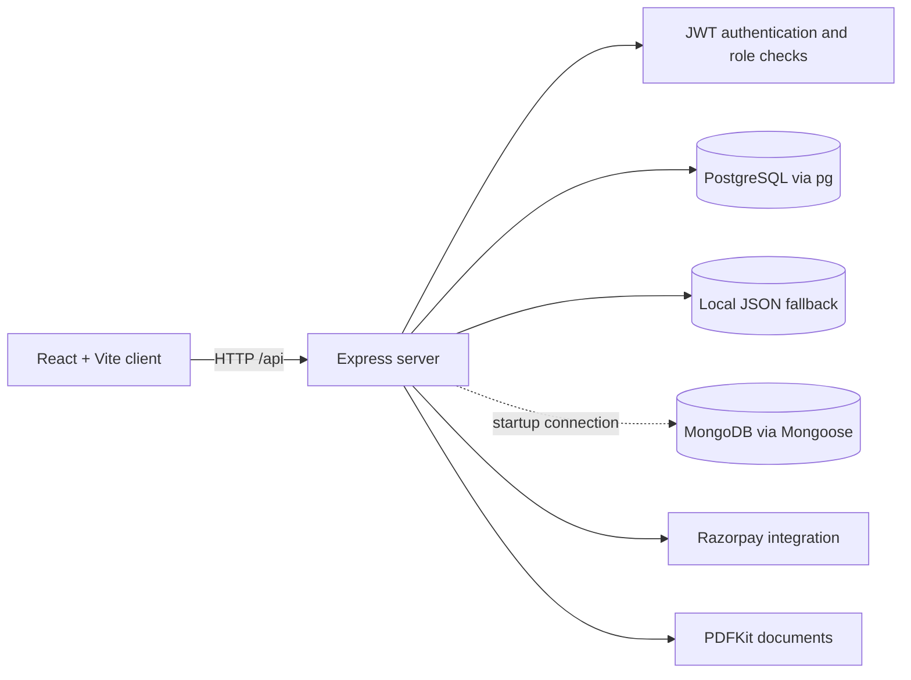

<h1 align="center">Hospital Management System</h1>

<p align="center">A full-stack web application for coordinating patient, doctor, appointment, and hospital administration workflows.</p>

<p align="center">
  
  
  
  
  
</p>

<p align="center">
  <a href="#overview">Overview</a> |
  <a href="#features">Features</a> |
  <a href="#architecture">Architecture</a> |
  <a href="#getting-started">Getting Started</a> |
  <a href="#api-overview">API</a> ·
  <a href="#screenshots">Screenshots</a>
</p>

## Table of Contents

- [Overview](#overview)
- [Features](#features)
- [Technology Stack](#technology-stack)
- [Architecture](#architecture)
- [Project Structure](#project-structure)
- [Getting Started](#getting-started)
- [Environment Variables](#environment-variables)
- [Run Locally](#run-locally)
- [API Overview](#api-overview)
- [Screenshots](#screenshots)
- [Future Scope](#future-scope)
- [Contributing](#contributing)
- [Developer](#developer)

## Overview

Hospital Management System is a learning-oriented, full-stack application with a public hospital landing page and separate patient, doctor, and administrator experiences. The React client communicates with an Express API for account access and healthcare workflows, including appointments, patient and doctor records, prescriptions, analytics, and payments.

The backend currently contains both PostgreSQL (`pg`) query code and a JSON-file fallback. It also attempts a MongoDB connection at startup, but the controllers inspected in this project use the PostgreSQL pool and fallback helpers rather than the Mongoose models. Database behavior therefore varies by workflow; see [Database configuration](#database-configuration) before using the application with real data.

## Features

- **Patient access:** Register and sign in, discover doctors by name or specialization, and manage appointment, medical record, prescription, and payment views.
- **Doctor workspace:** View appointments, access doctor pages, and create medical records and prescriptions through the API.
- **Administration:** Manage patient and doctor records, appointments, and view dashboard analytics. The UI also includes department, pharmacy, laboratory, billing, staff, reports, inventory, and settings pages.
- **Healthcare discovery:** Browse departments and search the sample doctor directory using disease and specialization terms.
- **API workflows:** Role-aware authentication, appointment operations, medical records, prescription PDFs, contact submissions, analytics, and Razorpay order/payment verification.
- **Fallback data mode:** Some controller workflows can use `server/fallback-db.json` when PostgreSQL is unavailable. This is local development/demo storage, not a production database.

## Technology Stack

| Area | Technologies |
| --- | --- |
| Frontend | React 18, JavaScript (ES modules), Vite 5, React Router, Axios, Tailwind CSS, Recharts |
| Backend | Node.js, Express 4, CommonJS, JWT, bcryptjs |
| Data access | PostgreSQL via `pg`; MongoDB connection via Mongoose; JSON fallback helpers |
| Integrations | Razorpay, PDFKit |
| Tooling | npm, Nodemon, PostCSS, Autoprefixer |

This repository uses JavaScript; TypeScript is not configured.

## Architecture



The client defaults to `http://localhost:5000` for the API. The Vite development server uses port `3001`; the backend defaults to port `5000`.

## Project Structure

```text
.
├── client/
│   ├── src/
│   │   ├── admin/       # Administrator login and pages
│   │   ├── data/        # Sample doctors and disease directory
│   │   ├── doctor/      # Doctor portal pages
│   │   ├── layout/      # Shared dashboard layout
│   │   ├── App.jsx      # Routes and patient workflows
│   │   └── HomePage.jsx # Public landing page
│   ├── package.json
│   └── vite.config.js
├── server/
│   ├── config/          # MongoDB connection setup
│   ├── controllers/     # API request handlers
│   ├── middleware/      # JWT and role middleware
│   ├── models/          # Mongoose model definitions
│   ├── routes/          # Express route modules
│   ├── fallback-db.json # Local fallback data
│   ├── fallbackDb.js
│   └── server.js        # API entry point
├── .gitignore
└── vercel.json          # Frontend route rewrite configuration
```

## Getting Started

### Prerequisites

- Node.js 18 or newer and npm
- PostgreSQL for the SQL-backed workflows
- MongoDB is optional for startup: a failed MongoDB connection is caught, and the server continues to start

### Install dependencies

Run each install from its own project directory:

```bash
cd server
npm install
```

```bash
cd client
npm install
```

### Environment Variables

Create `server/.env` and, if needed, `client/.env`. Use your own local values; never commit real credentials.

`server/.env`:

```dotenv
PORT=5000
JWT_SECRET=replace_with_a_long_random_secret
ADMIN_ACCESS_CODE=replace_with_a_private_admin_code

# PostgreSQL settings used by the pg connection pool
DB_USER=your_local_database_user
DB_HOST=127.0.0.1
DB_NAME=your_local_database_name
DB_PASSWORD=your_local_database_password
DB_PORT=5432

# MongoDB connection attempted by the server at startup
MONGO_URI=mongodb://127.0.0.1:27017/hospitalDB

# Optional Razorpay server credentials
RAZORPAY_KEY_ID=your_razorpay_key_id
RAZORPAY_KEY_SECRET=your_razorpay_key_secret
```

`client/.env`:

```dotenv
VITE_API_URL=http://localhost:5000
VITE_RAZORPAY_KEY_ID=your_razorpay_key_id
```

`VITE_API_URL` is the backend origin; the client appends `/api`. Variables prefixed with `VITE_` are bundled into browser code and must never contain secrets. Only use the public Razorpay key ID there, never the key secret.

### Database Configuration

The server attempts MongoDB using `MONGO_URI` when it starts. Current controllers, however, issue SQL queries through the PostgreSQL pool configured with `DB_USER`, `DB_HOST`, `DB_NAME`, `DB_PASSWORD`, and `DB_PORT`. Some handlers fall back to `server/fallback-db.json` if PostgreSQL is unavailable; this fallback is not implemented uniformly across every workflow. Mongoose model files are present, but are not the persistence path used by the inspected controllers.

No database schema/migration setup is included in the repository. Configure PostgreSQL with the schema expected by the SQL queries before relying on SQL-backed features. The JSON fallback is intended only for local experimentation.

## Run Locally

Open two terminals from the repository root.

**Backend** (port `5000` by default):

```bash
cd server
npm run dev
```

The server root health response is available at `http://localhost:5000/`.

**Frontend** (Vite port `3001`):

```bash
cd client
npm run dev
```

Open `http://localhost:3001` in your browser. For a production client bundle, run `npm run build` from `client/`.

## API Overview

All route groups are mounted under `/api`. The route modules below are the source of truth for methods and access middleware; send a bearer token for routes protected by `verifyToken`.

| Base path | Endpoints | Purpose |
| --- | --- | --- |
| `/api/auth` | `POST /register`, `POST /login`, `POST /admin-code-login`, `GET /admin-dashboard`, `GET /doctor-dashboard`, `GET /patient-dashboard` | Account access and role dashboards |
| `/api/appointments` | `GET /`, `POST /`, `GET /patient/:patientId`, `GET /:doctorId`, `PUT /:id/status`, `GET /doctor/live/:doctorId`, `PUT /doctor/live/:id/status` | Appointment creation, lookup, and status updates |
| `/api/doctors` | `GET /`, `POST /`, `PUT /:id`, `DELETE /:id` | Doctor directory administration |
| `/api/patients` | `GET /`, `POST /`, `PUT /:id`, `DELETE /:id` | Patient records |
| `/api/medical-records` | `POST /`, `GET /patient/:patientId`, `GET /:id`, `PUT /:id`, `DELETE /:id` | Medical record operations |
| `/api/prescriptions` | `POST /`, `GET /patient/:patientId`, `GET /:id/download` | Prescriptions and PDF download |
| `/api/payments` | `POST /create-order`, `POST /verify` | Razorpay order creation and payment verification |
| `/api/analytics` | `GET /appointments-per-month`, `GET /revenue-per-month`, `GET /most-booked-doctors`, `GET /patients-by-department` | Administrator analytics |
| `/api/contact` | `POST /` | Submit a contact message |

**Access note:** Route middleware is not consistent across every endpoint. In particular, the live appointment routes currently have no authentication middleware. Review and secure API access before deployment; this documentation does not imply that every route is production-ready.

## Screenshots

No application screenshots are currently included in the repository. To add genuine screenshots, capture the public home page, patient registration or dashboard, doctor appointments page, and administrator dashboard after running the application. Save sanitized images under a folder such as `docs/screenshots/` and avoid showing real patient information, tokens, or credentials.

## Future Scope

Potential next steps for the project:

- Choose and consistently implement one primary persistence layer, with documented schema setup and migrations.
- Add automated tests for authentication, role authorization, and the main patient and doctor workflows.
- Protect every API route consistently and validate inputs at the API boundary.
- Add deployment instructions, environment validation, and CI checks.
- Replace demo-only data and placeholder dashboard sections with persisted workflows.

## Contributing

Contributions are welcome. Open an issue to discuss a bug or proposed change, then submit a pull request with a focused description and verification steps. Do not include real patient data, secrets, generated invoices, or local environment files in contributions.

## Developer

**Vinay Dixit** | [GitHub profile](https://github.com/vinaydixit7078-jpg)
